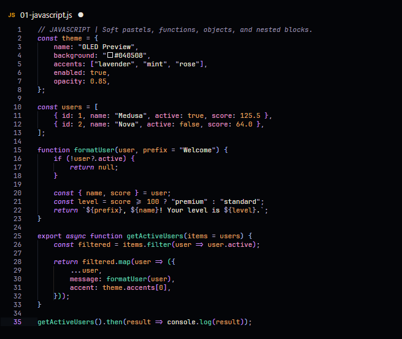
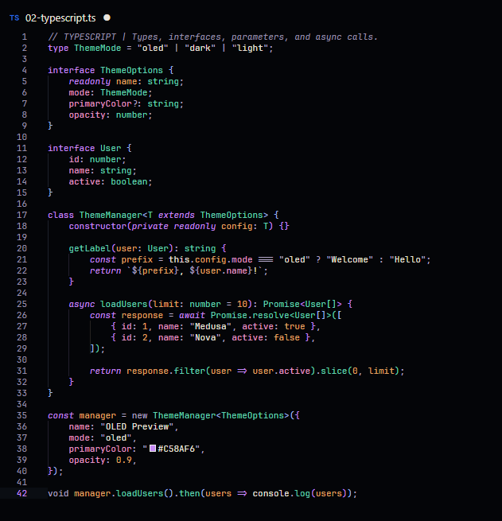
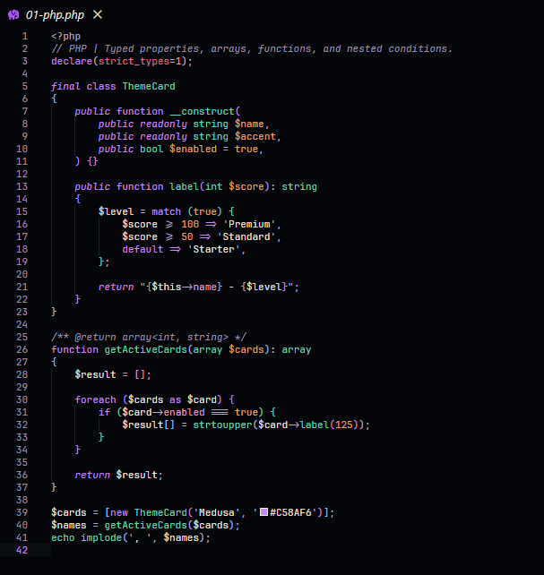
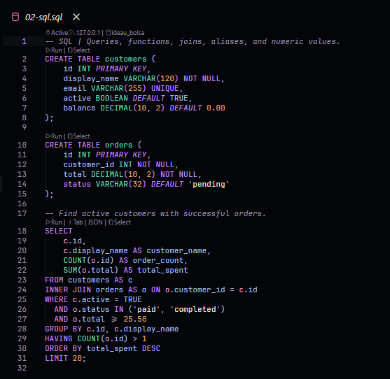
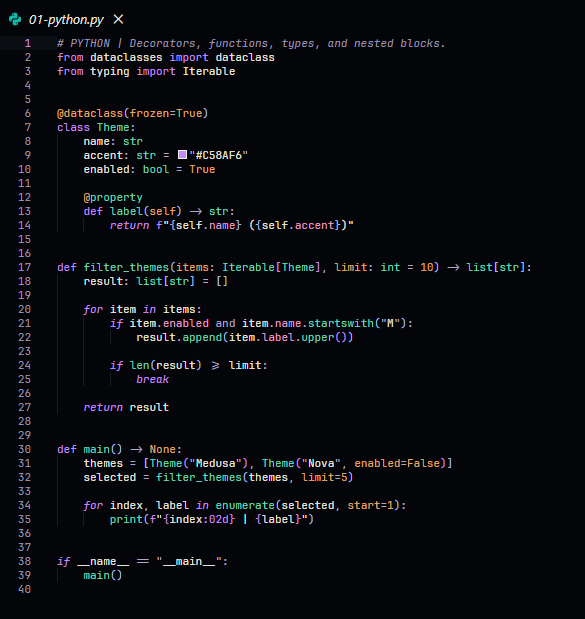
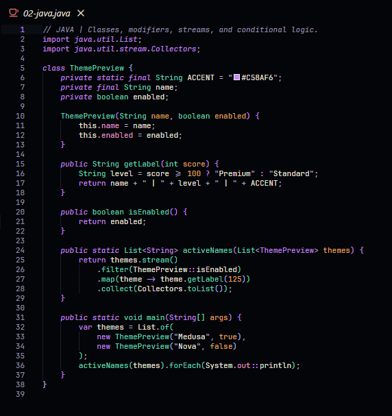
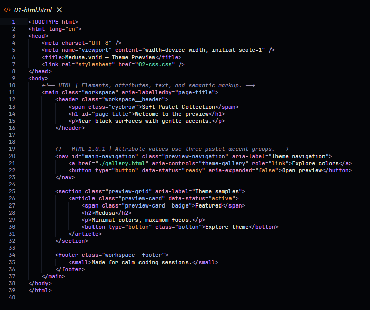
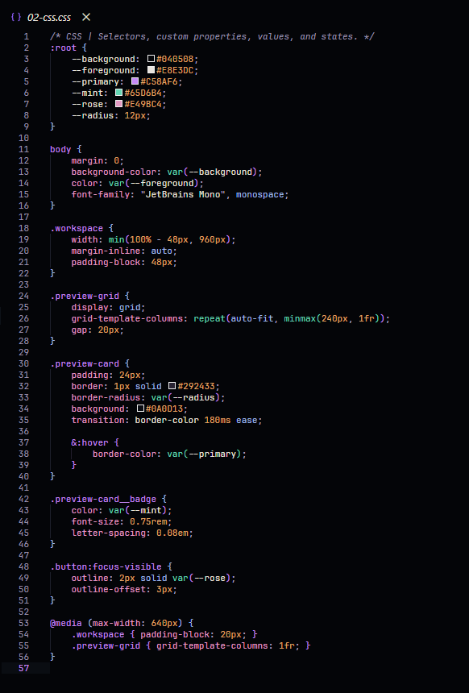
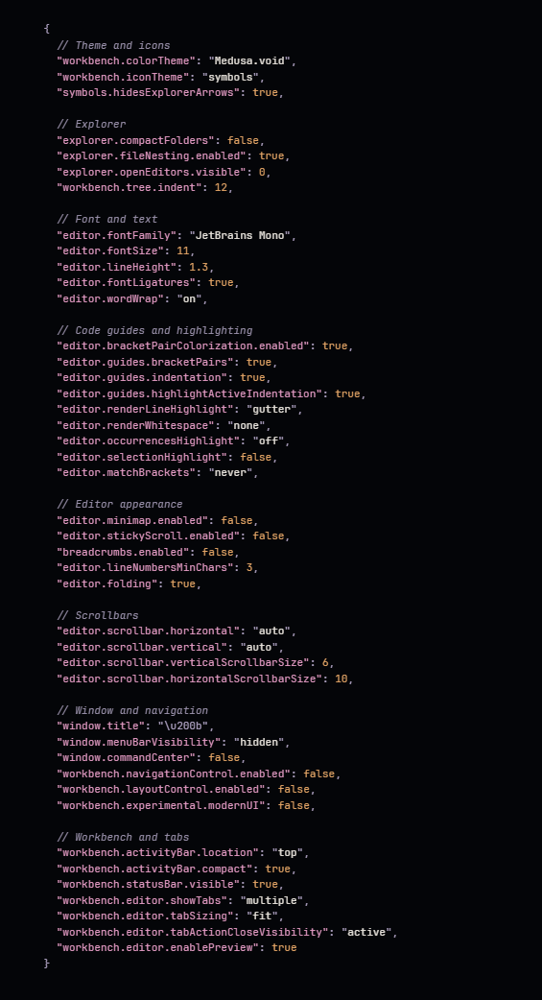

# Medusa.void


**A softer way to code in the dark.**

An OLED-dark Visual Studio Code theme inspired by Medusa, a calico cat.  
Near-black surfaces, warm ivory, caramel, violet accents, and carefully balanced pastel syntax.

<p>
  <a href="CHANGELOG.md" title="View release notes"></a>
  <a href="https://code.visualstudio.com/" title="Visual Studio Code"></a>
  <a href="LICENSE" title="Read the MIT License"></a>
</p>

<sub>Created by <strong>Kauê Gabriel Magarinos</strong> with <strong>Codex</strong>.</sub>

<br clear="all" />

---

## Color palette

Medusa.void takes its cues from Medusa’s black, ivory, and caramel coat, with violet as its signature accent. Each pastel shade has a purpose, making code easier to recognize across languages.

**Syntax colors**

<p align="left">
  
  
  
  
</p>

<p align="left">
  
  
  
  
</p>

**Interface accents**

<p align="left">
  
  
  
</p>

<details>
<summary><strong>Color roles and exact HEX values</strong></summary>

| Color | HEX | Usage |
| :-- | :-- | :-- |
| Violet | `#C58AF6` | Keywords, declarations, HTML tags, CSS selectors |
| Mint | `#65D6B4` | Functions, methods, types, HTML paths |
| Soft Rose | `#E49BC4` | Properties, attributes, recognized keys |
| Light Blue | `#A0BCEB` | SQL identifiers, CSS values, HTML classes and IDs |
| Warm Ivory | `#E8E3DC` | Variables, strings, interface text |
| Caramel | `#E4A566` | Parameters, decorators, numbers, constants, HTML states |
| Lilac Gray | `#B3A6C7` | Operators and punctuation |
| Violet Gray | `#9C93AD` | Comments |
| OLED | `#040508` | Editor and native interface background |
| Selection | `#181B25` | Text selection background |
| Git Modified | `#C7A7F2` | Modified-file decoration |

</details>

## Design philosophy

**Less noise. Clearer meaning.**

- **Color by role.** Related constructs use related colors across languages, helping you recognize functions, types, and properties at a glance.
- **Let text breathe.** Regular variables, strings, and user-facing text remain warm ivory rather than competing with every keyword.
- **Use accent colors with intention.** HTML can distinguish technical IDs, class names, paths, and state attributes without coloring ordinary text unnecessarily.
- **Keep the interface quiet.** Native panels, menus, and inputs use a consistent near-black OLED surface with subtle focus and selection states.

The eight principal syntax colors were checked for contrast against the editor (`#040508`) and selection (`#181B25`), with minimum calculated ratios of **6.98:1** and **5.88:1** respectively. These measurements complement, rather than replace, visual testing.

## Syntax gallery

Real screenshots from the VS Code editor, using English examples. Each language has its own screenshot — no side-by-side collages.

<p>
  
  <strong>JavaScript</strong>
</p>



<p>
  
  <strong>TypeScript</strong>
</p>



<p>
  
  <strong>PHP</strong>
</p>



<p>
  
  <strong>SQL</strong>
</p>



<p>
  
  <strong>Python</strong>
</p>



<p>
  
  <strong>Java</strong>
</p>



<p>
  
  <strong>HTML</strong>
</p>



<p>
  
  <strong>CSS</strong>
</p>



## Features

| | |
| :-- | :-- |
| **True-to-OLED surfaces** | `#040508` backgrounds across editor, menus, inputs, and native panels. |
| **Soft pastel syntax** | Eight color families organized by meaning, not visual noise. |
| **Gentle code guides** | Subtle pastel bracket-pair and indentation guides, when enabled in VS Code settings. |
| **Matching terminal** | Coordinated ANSI colors for the integrated terminal. |
| **Git & diff** | Lilac modified-file decorations and restrained addition/deletion highlights. |
| **Consistent UI** | Search, IntelliSense, menus, hover widgets, Settings, and Extensions. |

## Compatibility

- **Visual Studio Code:** version **1.85.0 or newer**, as declared by the extension's `package.json` (`"engines": { "vscode": "^1.85.0" }`).
- **Platforms:** Windows, macOS, and Linux versions of VS Code.
- **Dependencies:** None required for the color theme itself. Font choices, layout preferences, and file-icon themes are optional.
- **Language colors:** Syntax highlighting can vary slightly depending on the active language extension and semantic highlighting support.

## Downloads & releases

**Version 1.0.1** is the current project version.

- **[Download v1.0.1](https://github.com/Kaue-14/Medusa.void/releases/tag/v1.0.1)** — Get the installation package (`.vsix`).
- **[All releases](https://github.com/Kaue-14/Medusa.void/releases)** — Browse available versions.
- **[Release notes](CHANGELOG.md)** — Review changes between versions.

> The extension is available through GitHub Releases. Once approved and published on the VS Code Marketplace, it will also be installable directly from the Extensions view.

## Installation

**Install from a VSIX package:**

1. Open the VS Code **Extensions** view (`Ctrl+Shift+X`).
2. Open `...` and choose **Install from VSIX...**.
3. Select the Medusa.void `.vsix` file.
4. Open **Preferences: Color Theme** (`Ctrl+K`, then `Ctrl+T`).
5. Select **Medusa.void**.

**Marketplace:** Once the listing is live, open Extensions, search for **Medusa.void**, and select **Install**.

## Recommended editor settings <sub>(optional)</sub>

These settings reproduce the minimal VS Code appearance used in the preview. **They are not required:** the actual colors are part of Medusa.void. Fonts, layout, and file icons remain your choice.

<details>
<summary><strong>Preview the recommended settings in Medusa.void colors</strong></summary>



</details>

<details>
<summary><strong>Copy the full appearance-only settings.json</strong></summary>

```jsonc
{
  // Theme and icons
  "workbench.colorTheme": "Medusa.void",
  "workbench.iconTheme": "symbols",
  "symbols.hidesExplorerArrows": true,

  // Explorer
  "explorer.compactFolders": false,
  "explorer.fileNesting.enabled": true,
  "explorer.openEditors.visible": 0,
  "workbench.tree.indent": 12,

  // Font and text
  "editor.fontFamily": "JetBrains Mono",
  "editor.fontSize": 11,
  "editor.lineHeight": 1.3,
  "editor.fontLigatures": true,
  "editor.wordWrap": "on",

  // Code guides and highlighting
  "editor.bracketPairColorization.enabled": true,
  "editor.guides.bracketPairs": true,
  "editor.guides.indentation": true,
  "editor.guides.highlightActiveIndentation": true,
  "editor.renderLineHighlight": "gutter",
  "editor.renderWhitespace": "none",
  "editor.occurrencesHighlight": "off",
  "editor.selectionHighlight": false,
  "editor.matchBrackets": "never",

  // Editor appearance
  "editor.minimap.enabled": false,
  "editor.stickyScroll.enabled": false,
  "breadcrumbs.enabled": false,
  "editor.lineNumbersMinChars": 3,
  "editor.folding": true,

  // Scrollbars
  "editor.scrollbar.horizontal": "auto",
  "editor.scrollbar.vertical": "auto",
  "editor.scrollbar.verticalScrollbarSize": 6,
  "editor.scrollbar.horizontalScrollbarSize": 10,

  // Window and navigation
  "window.title": "\u200b",
  "window.menuBarVisibility": "hidden",
  "window.commandCenter": false,
  "workbench.navigationControl.enabled": false,
  "workbench.layoutControl.enabled": false,
  "workbench.experimental.modernUI": false,

  // Workbench and tabs
  "workbench.activityBar.location": "top",
  "workbench.activityBar.compact": true,
  "workbench.statusBar.visible": true,
  "workbench.editor.showTabs": "multiple",
  "workbench.editor.tabSizing": "fit",
  "workbench.editor.tabActionCloseVisibility": "active",
  "workbench.editor.enablePreview": true
}
```

</details>

> **Note:** The Symbols file icon theme is a separate extension. Some optional settings may vary by VS Code version; the theme works without them. The original Medusa pixel-art mascot is used as the **extension icon**, not as editor or file icons.
>
### Behind the Name 🐈

**Medusa.void** is named after my pet, Medusa, a calico cat who inspired the theme's identity.

The pixel-art mascot featured in the extension icon is based on her, bringing a personal touch to the project's design.

## Feedback & issues

Found a color that feels out of place, a contrast problem, or an inconsistent highlight?

**[Open an issue on GitHub](https://github.com/Kaue-14/Medusa.void/issues)** (when repository access and Issues are enabled). To help reproduce the problem, please include:

- The programming language and an example snippet.
- Your VS Code and Medusa.void versions.
- A screenshot showing the issue, if possible.

Suggestions and feedback are welcome, especially for language-specific syntax highlighting.

## Credits & license

**Medusa.void** was created by **Kauê Gabriel Magarinos** with **Codex**, inspired by his calico cat Medusa.

The pixel-art cat is the extension's original mascot. This project is distributed under the **MIT License**. See [LICENSE](LICENSE) and [Third-party notices](THIRD_PARTY_NOTICES.md) for license details and required acknowledgments.
